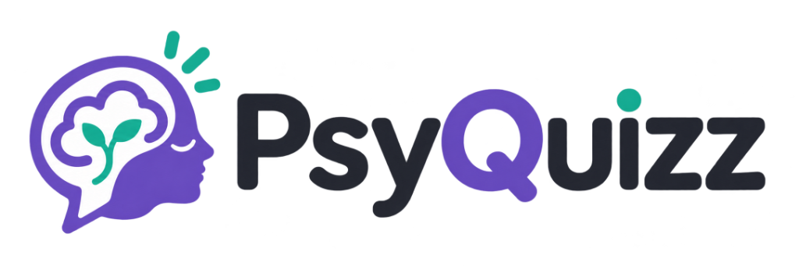
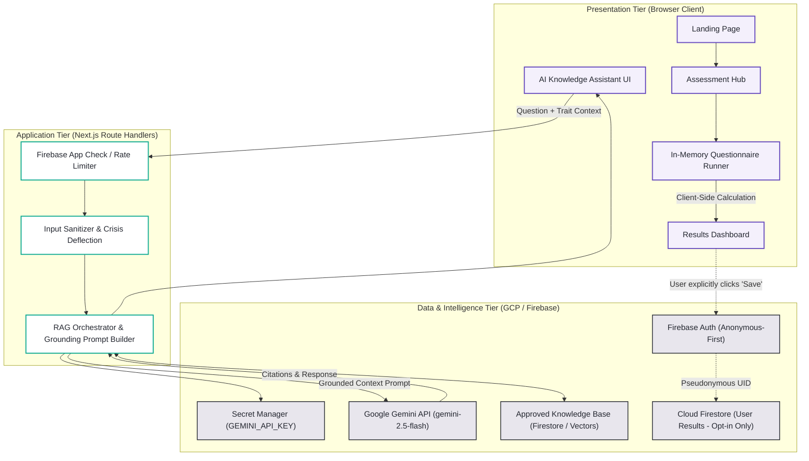

<div align="center">



<br/>

**Understand Yourself, One Insight at a Time.**

*A Privacy-First Psychological Self-Assessment & Science-Grounded AI Explanation Platform*

---

[](#10-development-roadmap)
[-blue?style=flat-square)](#1-project-overview)
[](#12-contributors--license)
[-success?style=flat-square)](#5-privacy--security-by-design)

</div>

---

> [!IMPORTANT]
> **ASSESSMENT & MEDICAL DISCLAIMER**  
> **PsyQuizz is NOT a medical diagnostic platform, emergency psychiatric service, or substitute for qualified clinical mental health care.**  
> All psychometric screenings, dimensional scoring models, and AI-generated insights provided by PsyQuizz are intended strictly for **self-reflection, educational exploration, and personal awareness**. If you are experiencing acute distress, mental health crises, or thoughts of self-harm, please seek immediate professional assistance or contact local crisis resources (e.g., Đường dây nóng Ngày Mai: `096 306 1414`, Tổng đài Quốc gia: `111`, Cấp cứu: `115`).

---

## 1. Project Overview

### 1.1 The Context & The Problem
In Vietnam, young adults and university students face growing pressures surrounding academic demands, career navigation, family expectations, and interpersonal relationships. According to **UNICEF Viet Nam (2022/2023)**, approximately **21.7%** of surveyed adolescents reported experiencing a mental health issue during the previous year (predominantly anxiety at 18.6% and depression at 4.3%), yet **only 8.4%** accessed professional counseling or support.

When seeking self-understanding online, young adults frequently encounter:
1. **Unreliable "Entertainment" Quizzes:** Pseudoscience tests with fabricated scoring and sensationalized conclusions.
2. **Privacy Risks & Aggressive Profiling:** Platforms requiring sensitive personal registration (names, phone numbers, social logins) and monetizing emotional vulnerability for commercial ad targeting.
3. **Misleading AI "Therapy" Bots:** Unconstrained Large Language Models that hallucinate clinical diagnoses, misinterpret psychometric scores, or lack evidence grounding.

### 1.2 The PsyQuizz Solution
**PsyQuizz** provides a safe, scientifically grounded, and privacy-conscious web platform where users can:
- Take validated psychological self-assessments (starting with public-domain psychometric instruments such as the **IPIP Big Five**).
- Receive immediate, transparent dimensional scoring calculated entirely **client-side** without mandatory registration.
- Explore evidence-grounded educational explanations powered by **Google Gemini**, strictly constrained by a **Verified Retrieval-Augmented Generation (RAG)** pipeline referencing reviewed psychological literature.
- Maintain full sovereignty over their data with a strict **Anonymous-First** design and zero cloud storage by default.

---

## 2. Key Modules & Implementation Status

| Module | Core Description | Implementation Status |
|---|---|---|
| **Module A: Landing Page** | Introduces brand identity, value proposition, how the system works, privacy commitment, and explicit non-diagnostic disclaimers. | ⏳ **Planned (Phase 1)** |
| **Module B: Assessment Hub** | Central directory of validated psychological instruments displaying construct scope, item count, duration, and legal/scientific licensing data. | ⏳ **Planned (Phase 1)** |
| **Module C: Assessment Experience** | Distraction-free, responsive questionnaire runner with real-time progress indicators, in-memory client-side state, and input validation. | ⏳ **Planned (Phase 2)** |
| **Module D: Results Dashboard** | Interactive dimensional score visualizations (radar/bar charts), plain-language interpretation bands, and explicit assessment limitations. | ⏳ **Planned (Phase 2)** |
| **Module E: AI Knowledge Assistant** | Server-side Gemini integration grounded in approved psychological literature, citing verified sources and refusing clinical diagnostic requests. | ⏳ **Planned (Phase 4 & 5)** |
| **Module F: Optional Anonymous Access** | Firebase Anonymous Authentication enabling pseudonymous bookmarking and optional saving without revealing identity. | ⏳ **Planned (Phase 3)** |

---

## 3. Technology Stack: Planned vs. Existing

Following a comprehensive repository audit, PsyQuizz is currently at the **Phase 0 (Architecture & Documentation)** stage. Below is the full technology stack distinguishing current repository status from planned implementation.

| Layer | Technology | Primary Purpose | Repository Status |
|---|---|---|---|
| **Frontend Framework** | [Next.js](https://nextjs.org/) (React 18+) | Server-side rendering, App Router, responsive client views | ⏳ *Planned (Phase 1)* |
| **Language** | [TypeScript](https://www.typescriptlang.org/) | Strict type safety, psychometric data modeling, and robust API contracts | ⏳ *Planned (Phase 1)* |
| **Styling & UI** | [Tailwind CSS](https://tailwindcss.com/) | Mobile-first styling utilizing PsyQuizz design tokens | ⏳ *Planned (Phase 1)* |
| **Client Auth** | [Firebase Authentication](https://firebase.google.com/docs/auth) | Anonymous-First authentication & optional credential linking | ⏳ *Planned (Phase 3)* |
| **Database** | [Cloud Firestore](https://firebase.google.com/docs/firestore) | Storing optional user-saved results and approved knowledge corpus | ⏳ *Planned (Phase 3)* |
| **Application Backend** | Next.js Server Route Handlers | Secure API proxy, rate limiting, and server-side orchestration | ⏳ *Planned (Phase 4)* |
| **AI Language Model** | [Google Gemini API](https://ai.google.dev/) (`gemini-2.5-flash`) | Evidence-grounded educational explanations & Q&A | ⏳ *Planned (Phase 4)* |
| **Knowledge Grounding** | Verified RAG Architecture | Multi-stage literature retrieval, metadata tracking, and citation delivery | ⏳ *Planned (Phase 5)* |
| **Secret Protection** | Google Cloud Secret Manager / Server Env | Isolating `GEMINI_API_KEY` and Firebase Admin credentials from client code | 🔒 **Defined (`.env.example`)** |
| **Application Protection** | [Firebase App Check](https://firebase.google.com/docs/app-check) (reCAPTCHA v3) | Anti-abuse protection, quota shielding, and API endpoint verification | ⏳ *Planned (Phase 3)* |
| **Version Control** | [Git](https://git-scm.com/) & [GitHub](https://github.com/hoangcamanh/PsyQuizz) | Baseline repository, version control, issue tracking, and roadmap | ✅ **Configured (Phase 0)** |

---

## 4. System Architecture

PsyQuizz adopts a multi-tier architecture that rigorously isolates the **client-side privacy-first assessment path** from the **server-side AI knowledge grounding path**.



For complete technical specifications and Architectural Decision Records (ADRs), see [`docs/ARCHITECTURE.md`](docs/ARCHITECTURE.md).

---

## 5. Privacy & Security by Design

PsyQuizz is engineered around the principle that **psychological reflections are strictly personal**:

1. **Anonymous-First Processing:** Visitors take assessments in a local, volatile browser session. Questionnaire answers and score tallies are computed using client-side JavaScript. If the visitor leaves without saving, zero traces exist on any server.
2. **Distinguishing Pseudonymity from True Anonymity:** When optional cloud features are activated, Firebase Anonymous Auth assigns an app-specific `uid`. PsyQuizz documentation and UX never falsely represent pseudonymity as untraceable anonymity.
3. **Viet Nam Law No. 91/2025/QH15 Compliance:** The platform strictly adheres to Vietnam's Personal Data Protection Law (effective 1 January 2026), enforcing data minimization, lawful consent, zero commercial ad profiling on psychological data, and a one-click user data purge.
4. **Credential Isolation:** Client bundles contain **zero** server credentials. The `GEMINI_API_KEY` is maintained exclusively within server-side execution environments, shielded by App Check and rate limiters.
5. **Declarative Firestore Rules:** Unauthenticated access is blocked. Users can only read and write their own documents under `/users/{userId}/results/{resultId}`.

For complete rulesets and security protocols, see [`docs/SECURITY.md`](docs/SECURITY.md).

---

## 6. AI & Verified RAG Architecture

PsyQuizz rejects "black-box" conversational AI for psychological content. The **AI Knowledge Assistant** operates under a structured **Verified RAG (Retrieval-Augmented Generation)** framework:

```mermaid
flowchart LR
    S1["1. Source Acquisition<br/>(Journals, Manuals, WHO)"] --> S2["2. Source Screening<br/>(Quality & Licensing QA)"]
    S2 --> S3["3. Professional Review<br/>(Expert Sign-off)"]
    S3 --> S4["4. Approved Repository<br/>(Versioned Corpus)"]
    S4 --> S5["5. Semantic Retrieval<br/>(Query Match)"]
    S5 --> S6["6. Grounded Prompt<br/>(Context Injection)"]
    S6 --> S7["7. Gemini Generation<br/>(gemini-2.5-flash)"]
    S7 --> S8["8. Cited Response<br/>(With Source Links)"]

    classDef stage fill:#F4F0FC,stroke:#674BBE,stroke-width:1.5px,color:#242730;
    class S1,S2,S3,S4,S5,S6,S7,S8 stage;
```



### The Role of NotebookLM
- **Internal Research & Synthesis Only:** NotebookLM serves as an internal desktop research tool for team members to curate, summarize, and cross-reference psychological literature.
- **Not Live Production Runtime:** The production website does not query personal NotebookLM notebooks directly. Instead, verified materials are exported into an approved, indexed knowledge repository accessible to the server-side RAG engine.

---

## 7. Project Structure

```text
psy_quizz/
├── .env.example              # Configuration template for environment variables
├── .gitignore                # Git exclusions (credentials, build output, dependencies)
├── README.md                 # Primary project documentation
├── assets/                   # Brand assets and visual identity
│   ├── README.md             # Asset specification and visual token guide
│   └── logo.png              # Official PsyQuizz brand logo
├── docs/                     # Detailed architectural specifications
│   ├── ARCHITECTURE.md       # Multi-tier architecture and ADRs
│   ├── ROADMAP.md            # Phased implementation plan and decision gates
│   └── SECURITY.md           # Privacy-by-design, Firestore rules & security model
└── (Application source to be initialized in Phase 1)
```

---

## 8. Getting Started

### 8.1 Prerequisites
- [Node.js](https://nodejs.org/) (v18.17+ or v20 LTS recommended)
- `npm` (v9+) or `pnpm`
- A [Google Cloud / Firebase](https://console.firebase.google.com/) project (for authentication and Firestore)
- A [Google AI Studio](https://aistudio.google.com/) API key (for Gemini API)

### 8.2 Configuration Setup
1. Clone the repository:
   ```bash
   git clone https://github.com/hoangcamanh/PsyQuizz.git
   cd PsyQuizz
   ```
2. Prepare your local environment file:
   ```bash
   cp .env.example .env.local
   ```
3. Populate `.env.local` with your development credentials (see [Environment Variables](#9-environment-variables)).

### 8.3 Development Execution (Phase 1 onward)
```bash
# Install dependencies
npm install

# Run development server
npm run dev

# Run test suite
npm run test
```

---

## 9. Environment Variables

All environment variables must be declared in `.env.example` before use. **Never commit real credentials to Git.**

| Variable Name | Environment | Purpose |
|---|---|---|
| `NEXT_PUBLIC_FIREBASE_API_KEY` | Client (Public) | Firebase Web SDK configuration |
| `NEXT_PUBLIC_FIREBASE_AUTH_DOMAIN` | Client (Public) | Firebase Auth domain handler |
| `NEXT_PUBLIC_FIREBASE_PROJECT_ID` | Client (Public) | Google Cloud / Firebase Project ID |
| `NEXT_PUBLIC_APP_CHECK_SITE_KEY` | Client (Public) | reCAPTCHA v3 site key for App Check |
| `GEMINI_API_KEY` | Server (Secret) | Google Gemini API key for server-side RAG |
| `GEMINI_MODEL` | Server (Secret) | Target model (`gemini-2.5-flash`) |
| `FIREBASE_ADMIN_PROJECT_ID` | Server (Secret) | Firebase Admin SDK Project ID |
| `FIREBASE_ADMIN_CLIENT_EMAIL` | Server (Secret) | Firebase Admin Service Account email |
| `FIREBASE_ADMIN_PRIVATE_KEY` | Server (Secret) | Firebase Admin private key |

---

## 10. Development Roadmap

- [x] **Phase 0: Repository Audit & Architectural Planning** *(Current Milestone)*
  - [x] Baseline filesystem audit, clean `.gitignore`, environment template.
  - [x] Architecture specification (`docs/ARCHITECTURE.md`).
  - [x] Privacy & Security specification (`docs/SECURITY.md`).
  - [x] Development roadmap (`docs/ROADMAP.md`).
  - [x] Official brand logo integration (`assets/logo.png`).
  - [x] Professional GitHub README.
  - [x] Initial documentation commit and remote synchronization.
- [ ] **Phase 1: Frontend Foundation & Design System**
  - [ ] Next.js + TypeScript scaffold with Tailwind CSS tokens.
  - [ ] Module A: Landing Page with prominent disclaimers.
  - [ ] Module B: Assessment Hub with instrument directory.
- [ ] **Phase 2: Assessment Engine & Validated Scoring**
  - [ ] Validated IPIP Big Five client-side questionnaire runner.
  - [ ] Reverse-scored item calculation algorithms & unit tests.
  - [ ] Module D: Results Dashboard with radar charts and limitation notes.
- [ ] **Phase 3: Privacy Architecture & Firebase Backend**
  - [ ] Firebase Anonymous Authentication integration.
  - [ ] Opt-in results saving with granular Firestore Security Rules.
  - [ ] Self-service user data purge feature.
- [ ] **Phase 4: Gemini AI Assistant & Guardrails**
  - [ ] Server-side `/api/assistant` route handler with Secret Manager.
  - [ ] Crisis deflection filter & non-diagnostic boundaries.
- [ ] **Phase 5: Verified RAG & Literature Grounding**
  - [ ] Knowledge repository ingestion & vector indexing.
  - [ ] Dynamic grounding prompt synthesis & citation verification.
- [ ] **Phase 6: Hardening, Automated Testing & Production Deployment**
  - [ ] E2E testing (Playwright), accessibility auditing (WCAG 2.1 AA).
  - [ ] Deployment to Firebase App Hosting / Cloud Run.

For detailed phase milestones and decision gates, see [`docs/ROADMAP.md`](docs/ROADMAP.md).

---

## 11. Documentation & References

### Project Specifications
- [System Architecture Specification](docs/ARCHITECTURE.md)
- [Security & Privacy Specification](docs/SECURITY.md)
- [Development Roadmap & Decision Gates](docs/ROADMAP.md)
- [Brand Asset Specification](assets/README.md)

### Academic & Scientific Grounding
- **International Personality Item Pool (IPIP):** [ipip.ori.org](https://ipip.ori.org/) — *Public-domain Big Five instrument scales and scoring guidelines.*
- **UNICEF Viet Nam Mental Health Data (2022/2023):** [unicef.org/vietnam](https://www.unicef.org/vietnam/) — *Adolescent mental health prevalence and service gap reports.*
- **Depression Anxiety Stress Scales (DASS):** [dass.psy.unsw.edu.au](https://dass.psy.unsw.edu.au/) — *Guidelines on administration restrictions.*
- **World Health Organization (WHO):** [Ethics and governance of artificial intelligence for health](https://www.who.int/publications/i/item/9789240029200)

### Technical References
- [Next.js Documentation](https://nextjs.org/docs)
- [Google Gemini API Documentation](https://ai.google.dev/gemini-api/docs)
- [Firebase Authentication (Anonymous)](https://firebase.google.com/docs/auth/web/anonymous-auth)
- [Cloud Firestore Security Rules](https://firebase.google.com/docs/firestore/security/get-started)
- [Firebase App Check](https://firebase.google.com/docs/app-check)

---

## 12. Contributors & License

- **Project Group:** Group 10 — University Entrepreneurship Project
- **Repository Maintainer:** [@hoangcamanh](https://github.com/hoangcamanh)
- **Licensing:** Proprietary Academic / Open Access Evaluation (Official license pending project commercialization review). All validated psychological instruments (e.g. IPIP) remain subject to their respective original public domain / institutional licenses.
