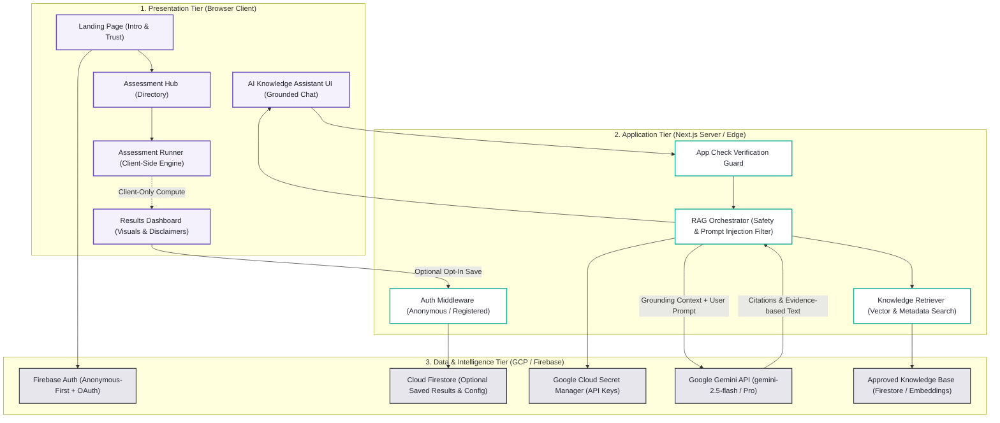
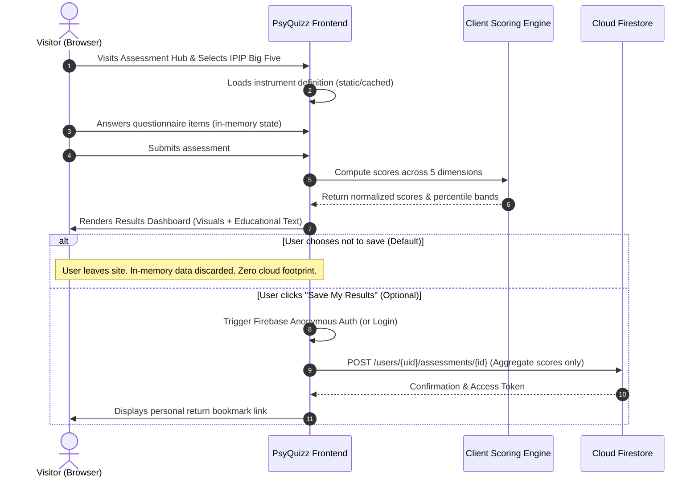
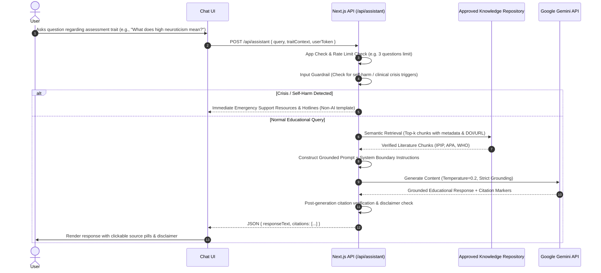

# System Architecture Specification — PsyQuizz

> **Status:** Proposed Architecture (Phase 0 Audit & Planning)  
> **Target Audience:** Engineering Team, Academic Reviewers, System Maintainers  
> **Document Version:** 1.0.0  
> **Last Updated:** November 2026

---

## 1. Executive Summary & Design Philosophy

**PsyQuizz** is a privacy-first web platform combining scientifically grounded psychological self-assessments with evidence-backed AI educational explanations. It is designed for Vietnamese university students and young adults (aged 18–30) seeking reliable tools for self-discovery and emotional awareness without clinical stigmatization or privacy invasion.

### Core Architectural Pillars
1. **Privacy-by-Design (Anonymous-First):** Psychological assessments are calculated entirely client-side by default. No personal identity or sensitive assessment responses are persisted to a cloud database without explicit, voluntary user consent.
2. **Verified RAG Knowledge Grounding:** AI educational explanations are not generated from unconstrained model hallucinations. Responses are strictly grounded in an approved, peer-reviewed psychological literature repository.
3. **Strict Non-Diagnostic Boundary:** System interfaces and AI outputs maintain an absolute boundary between educational screening/self-reflection and clinical diagnosis.

---

## 2. Multi-Tier Logical Architecture

The PsyQuizz architecture separates presentation, application logic, and cloud services into three distinct tiers.

---

## 3. Tier Deep-Dive

### 3.1 Presentation Tier (Frontend)
- **Framework:** Next.js (App Router) + React.
- **Language:** TypeScript (strict type checking enabled).
- **Styling:** Tailwind CSS with standardized design tokens matching PsyQuizz brand guidelines (`#674BBE` Primary Purple, `#14AC94` Accent Teal, `#F4F0FC` Soft Lavender, `#242730` Charcoal).
- **Client Execution:** The assessment questionnaire runner, item validation, and scoring algorithms (e.g., IPIP Big Five) run **100% in-browser**. If the user closes the browser or declines to save, all responses vanish immediately without network transmission.

### 3.2 Application Tier (Server-Side Orchestration)
- **Runtime:** Next.js Server Route Handlers / Edge Middleware running in a protected Node.js environment.
- **Security Interceptors:**
  - **Firebase App Check:** Verifies incoming requests originate from legitimate PsyQuizz web clients using reCAPTCHA v3 or Enterprise attestation.
  - **Prompt Sanitization & Injection Defense:** Strips adversarial prompts, instruction override attempts, and personally identifiable information (PII) before external API dispatch.
  - **Rate Limiting:** Enforces fair usage quotas (e.g., maximum 3 free questions per guest session) to control operating costs.

### 3.3 Data & Intelligence Tier
- **Authentication (Firebase Auth):**
  - **Anonymous-First:** Guest users obtain an ephemeral pseudonymous `uid` via `signInAnonymously()` only when triggering optional features.
  - **Account Linking:** Users can subsequently link email or Google credentials to preserve history across devices.
- **Database (Cloud Firestore):**
  - Enforces strict Firestore Security Rules.
  - Read/Write restricted to authenticated owner (`request.auth.uid == userId`).
  - Read-only public access for published, non-sensitive assessment definitions and approved knowledge references.
- **Secret Management:** Google Cloud Secret Manager or private server-only environment variables (`GEMINI_API_KEY`). No secrets are bundled into client code.
- **AI Processing (Gemini API):** Invoked via server-side SDK using `gemini-2.5-flash` for high-speed, cost-effective, grounded educational text generation.

---

## 4. Architectural Decision Records (ADRs)

### ADR-01: Server-Side Gemini API Orchestration vs. Firebase AI Logic Client Proxy
* **Context:** Google provides two primary integration pathways: Option A (Server-Side Route Handlers calling the Gemini API SDK) and Option B (Firebase AI Logic client proxy using App Check).
* **Evaluation:**
  - *Option B (Firebase AI Logic)* enables direct browser-to-Firebase calls but delegates prompt assembly, knowledge retrieval, and output sanitization to the client or generic Firebase extensions.
  - *Option A (Server-Side Orchestration)* gives PsyQuizz complete control over the multi-step **Verified RAG pipeline**: vector retrieval against approved psychological literature, prompt injection screening, injection of strict non-diagnostic system instructions, and verification of citations prior to client delivery.
* **Decision:** **Adopt Option A (Server-Side Gemini API via Next.js Route Handlers).**
* **Rationale:** Keeps knowledge repository embeddings private, guarantees system prompt integrity, prevents prompt leakage, isolates API keys completely, and supports strict response governance.

### ADR-02: Client-Side Default Assessment Processing (Privacy-by-Design)
* **Context:** Psychological survey answers contain sensitive personal reflections (e.g., stress indicators, personality dimensions).
* **Decision:** All core assessment item responses and scoring calculations execute client-side. No intermediate quiz answers are sent to Firestore during the test.
* **Rationale:** Complies directly with Vietnam's **Law on Personal Data Protection (Law No. 91/2025/QH15)** and global privacy standards. Eliminates the risk of leaking incomplete psychological responses in data breaches. Only aggregate dimension scores are saved if and when the user clicks "Save My Results".

### ADR-03: Separation of NotebookLM and Production Runtime RAG
* **Context:** The team's project notes mention NotebookLM.
* **Decision:** Clarify boundaries. **NotebookLM is designated as an internal academic research, literature comparison, and syllabus curation tool for human reviewers.** It is not deployed as the live production runtime RAG engine.
* **Rationale:** As of 2026, NotebookLM is designed for interactive human research workspaces, not automated, headless, high-concurrency production API querying. The production website uses Cloud Firestore / Vector Search + Gemini API grounded on the curated corpus exported from research.

---

## 5. End-to-End User Interaction Flows

### Flow 1: Anonymous-First Assessment Execution

### Flow 2: Verified RAG Educational Q&A

---

## 6. Target Module Specifications

### Module A — Landing Page
* Clear value proposition, visual identity (Purple `#674BBE` / Teal `#14AC94`), educational mission.
* Prominent, non-dismissible non-diagnostic disclaimer.
* Direct action: "Khám phá bản thân" (Explore Yourself) leading to the Assessment Hub.

### Module B — Assessment Hub
* Directory of verified psychological instruments.
* Initial Pilot Instrument: **IPIP Big Five (50-item / 20-item Short Form)** — Public Domain.
* Instrument card details: construct description, item count, estimated completion time, scientific validity references, and clear statements of what the test can and cannot reveal.
* Restricted instruments (e.g., DASS-21, Adult ADHD screening) displayed as *Under Scientific & Licensing Review*.

### Module C — Assessment Experience
* Single-item or paginated mobile-first card interface.
* Progress bar, back/forward navigation, validation ensuring all items in a dimension are addressed.
* Local state management (React Context / in-memory Zustand) with zero network transmissions during test execution.

### Module D — Results Dashboard
* Radar/Bar chart visualization of validated psychometric dimensions (Openness, Conscientiousness, Extraversion, Agreeableness, Neuroticism/Emotional Stability).
* Plain-language educational interpretation of score bands.
* Explicit section: *"Những điều kết quả này KHÔNG thể hiện"* (Limitations of this self-assessment).
* Actions: "Hỏi Trợ lý AI" (Ask AI Assistant), "Lưu kết quả" (Save), "Xóa phiên" (Reset/Purge).

### Module E — AI Knowledge Assistant
* Educational dialogue interface bounded by verified psychological knowledge.
* Grounded in approved literature (WHO guidelines, academic textbooks, published validation studies).
* Refuses diagnostic requests ("Do I have depression?", "Diagnose me with ADHD") with pre-written educational redirects and professional referral signposts.

### Module F — Optional Anonymous Access
* Firebase Anonymous Authentication integration.
* Allows users to bookmark their result or access it during the same session without disclosing email, phone number, or social media identity.

