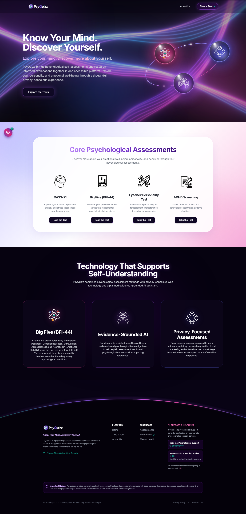

# PsyQuizz — Landing Page UI Specification & Showcase

> **Status:** Production Reference  
> **Target Audience:** Engineering Team, Designers, Academic Reviewers  
> **Last Updated:** November 2026

---

## 1. Full-Page Landing Page Overview

Below is the verified full-screen capture of the PsyQuizz landing page running in production:

---

## 2. Page Structure & Components

The landing page consists of four core thematic sections designed to deliver an educational, trustworthy, and visually captivating experience:

### A. Navigation & Top Header (`src/components/Header.tsx`)
- **Branding:** High-contrast PsyQuizz wordmark logo with white typography and colorful icon.
- **Navigation:**
  - `About Us` — Smooth scroll anchor to foundational philosophy.
  - `Take a Test` — Direct action button pointing to the assessment section (`#assessments`).
- **Styling:** Transparent blur at the top (`bg-[#080314]/30 backdrop-blur-sm`), transitioning seamlessly to solid glassmorphism (`bg-[#080314]/90 backdrop-blur-xl`) upon scrolling.

### B. Cosmic Silky Wave Hero Section (`src/components/HeroSection.tsx`)
- **WebGL Interactive Background:** Real-time fluid wave shader rendered with Three.js/WebGL (`WaveBackground.tsx`).
- **Cosmic Orbit System:** Multi-orbit 3D bubble system showcasing technology pillars:
  - *Evidence-Grounded AI*
  - *Big Five (BFI-44)*
  - *Privacy-Focused Assessments*
- **Primary Messaging:**
  - **Headline:** `Know Your Mind. Discover Yourself.`
  - **Subheadline:** `Explore your mind. Discover more about yourself.`
  - **CTA:** `Explore the Tests` (smooth-scrolls to `#assessments`).

### C. Core Psychological Assessments (`src/components/PurposeSection.tsx`)
- **Container:** Giant luminous white glassmorphic card with subtle pastel drop-shadow.
- **Section Heading:** `Core Psychological Assessments`
- **Assessment Cards (4 Columns Desktop / 2×2 Tablet / 1 Column Mobile):**
  1. **DASS-21:** Depression, anxiety, and stress symptom exploration over the past week (`/elements/health-wellness.png`).
  2. **Big Five (BFI-44):** 44-item Big Five Inventory evaluating five core personality traits (`/elements/video-game.png`).
  3. **Eysenck Personality Test:** Personality and temperament evaluation via external provider (`/elements/omic-technologies.png`).
  4. **ADHD Screening:** Structured attention and focus symptom screening (`/elements/applied-research.png`).
- **Interactive Pre-Test Modal (`src/components/AssessmentModal.tsx`):**
  - Clinical/academic briefing presented before initiating any test.
  - Sections: *About this assessment*, *What is it for?*, *How to complete the assessment*, and *Important Notice* (strict non-diagnostic medical disclaimer).
  - Actions: `Back` and `I Understand` (opens secure destination in a new tab).

### D. Technology That Supports Self-Understanding (`src/components/TechnologySection.tsx`)
- Dark section featuring three tech pillars with glowing neon borders:
  1. **Big Five (BFI-44):** Atom element icon.
  2. **Evidence-Grounded AI:** Hands holding globe gear element icon.
  3. **Privacy-Focused Assessments:** Network nodes element icon.

### E. Parabolic Arc Footer (`src/components/Footer.tsx`)
- **Parabolic Arc Transition:** Mathematical SVG glowing parabola transitioning into deep space black.
- **Content:** Tightly centered layout (`max-w-5xl`) with Brand info, Platform links, Scientific References, Support & Helplines (Vietnam emergency & psychological support lines), and non-diagnostic legal disclaimer.

---

## 3. Asset Specifications

| Asset | Path | Description |
| :--- | :--- | :--- |
| Full Screenshot | `docs/landing-page-full.png` | 1414×2948px high-resolution rendering |
| Health / Wellness Icon | `public/elements/health-wellness.png` | Head with brain/heart emblem |
| Video Game Console Icon | `public/elements/video-game.png` | Handheld gaming console emblem |
| Omics Icon | `public/elements/omic-technologies.png` | DNA helix and molecular node emblem |
| Research Icon | `public/elements/applied-research.png` | Microscope and research document emblem |
| Tech Atom Icon | `public/elements/tech-atom-white.png` | Stylized atomic orbital structure |
| Tech AI Hands Icon | `public/elements/tech-ai-hands-white.png` | Protective hands surrounding AI globe |
| Tech Network Icon | `public/elements/tech-network-node-white.png` | Connected decentralized node network |

