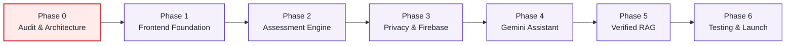

# Development Roadmap & Implementation Plan — PsyQuizz

> **Project Phase:** University Entrepreneurship Project / MVP Validation  
> **Initial Baseline:** Greenfield / Repository Audit  
> **Document Version:** 1.0.0  
> **Last Updated:** November 2026

---

## 1. Phased Development Overview

The PsyQuizz development roadmap follows a disciplined, evidence-based progression designed to validate customer demand and ensure clinical/legal safety prior to any feature expansion.

---

## 2. Phase Breakdown & Deliverables

### Phase 0 — Repository Audit & Architectural Planning
**Status:** 🔄 **In Progress (Current Milestone)**  
**Objectives:** Establish the baseline repository, audit existing code/assets, define the technical architecture, and formulate production-grade documentation.

- [x] Inspect local filesystem, detect language/framework presence, locate brand assets.
- [x] Initialize Git repository with `main` branch and configure GitHub remote (`hoangcamanh/PsyQuizz`).
- [x] Produce comprehensive `.gitignore` avoiding accidental leak of credentials or node artifacts.
- [x] Produce environment template (`.env.example`) documenting all required Firebase and Gemini keys.
- [x] Define Multi-Tier Architecture Specification (`docs/ARCHITECTURE.md`).
- [x] Define Privacy-by-Design and Security Specification (`docs/SECURITY.md`).
- [x] Establish Phased Implementation Roadmap (`docs/ROADMAP.md`).
- [x] Produce professional, GitHub-ready project `README.md`.
- [ ] Push baseline documentation commit to `https://github.com/hoangcamanh/PsyQuizz`.

---

### Phase 1 — Frontend Foundation & Design System
**Status:** ⏳ **Planned**  
**Objectives:** Scaffold the Next.js project with TypeScript, Tailwind CSS, and PsyQuizz design tokens.

- [ ] Initialize Next.js 14+ (App Router) project with TypeScript and strict type checking.
- [ ] Configure Tailwind CSS with official PsyQuizz color tokens:
  - Primary Purple: `#674BBE`
  - Accent Teal: `#14AC94`
  - Charcoal: `#242730`
  - Soft Lavender: `#F4F0FC`
  - Canvas White: `#FFFFFF`
- [ ] Set up web fonts (`Nunito Sans` for headings, `Inter` for interface/body).
- [ ] Build reusable UI atomic components: `Button`, `Card`, `Badge`, `Modal`, `ProgressBar`, `Alert`.
- [ ] Construct **Module A: Landing Page**:
  - Hero section with value proposition.
  - Explanatory "How PsyQuizz Works" workflow cards.
  - Privacy-first commitment banner.
  - Prominent, non-dismissible non-diagnostic disclaimer.
- [ ] Construct **Module B: Assessment Hub**:
  - Grid of available instruments with metadata (duration, item count, validity references).
  - Clear labeling distinguishing public domain instruments (IPIP Big Five) from measures under clinical review.

---

### Phase 2 — Assessment Engine & Validated Scoring
**Status:** ⏳ **Planned**  
**Objectives:** Build the client-side questionnaire runner and validated scoring engine for the initial MVP instrument.

- [ ] Implement validated **IPIP Big Five (50-item / 20-item short form)** questionnaire definition:
  - Extraversion, Agreeableness, Conscientiousness, Emotional Stability / Neuroticism, Intellect / Openness.
  - Standard 5-point Likert scale (1 = Very Inaccurate to 5 = Very Accurate).
  - Accurate reverse-coded item transformations.
- [ ] Build **Module C: Assessment Experience**:
  - Distraction-free mobile-responsive card interface.
  - Real-time progress bar and section indicators.
  - In-memory state management (zero network requests during test taking).
  - Form validation preventing accidental submission with missing items.
- [ ] Build **Module D: Results Dashboard**:
  - Dimension breakdown with radar/bar charts (Chart.js or Recharts).
  - Plain-language educational score interpretation bands (Low, Moderate, High).
  - Prominent "What this result CANNOT establish" limitations box.
  - Client-side PDF or shareable summary export (without transmitting raw data to server).
- [ ] Unit test suite for scoring algorithms verifying accurate calculation and reverse-keying against known test cases.

---

### Phase 3 — Privacy Architecture & Firebase Backend
**Status:** ⏳ **Planned**  
**Objectives:** Integrate Firebase Anonymous Authentication, Cloud Firestore, and granular security rules.

- [ ] Configure Firebase Client SDK in Next.js.
- [ ] Implement **Module F: Optional Anonymous User Access**:
  - Client invocation of `signInAnonymously()`.
  - Ephemeral user session state.
- [ ] Implement optional "Save My Results" action:
  - Stores only calculated dimension scores in `/users/{uid}/results/{resultId}`.
  - Never stores raw item responses.
- [ ] Deploy and verify `firestore.rules`:
  - Enforce owner-only read/write permissions.
  - Public read-only access for `/assessments` and `/knowledge_base`.
- [ ] Implement one-click "Purge My Data" feature that deletes the Firestore user record and clears local storage.
- [ ] Configure Firebase App Check with reCAPTCHA v3 / Enterprise.

---

### Phase 4 — Gemini AI Knowledge Assistant
**Status:** ⏳ **Planned**  
**Objectives:** Build the secured server-side Gemini integration and chat interface.

- [ ] Create server-side API route handler (`POST /api/assistant`).
- [ ] Securely inject `GEMINI_API_KEY` from private environment / Google Cloud Secret Manager.
- [ ] Implement AI input guardrails:
  - Crisis detection interceptor: Regex and semantic screening for crisis, suicide, or self-harm keywords.
  - Immediate redirection to Vietnamese mental health hotlines (Đường dây nóng Ngày Mai `096 306 1414`, Tổng đài `111`).
  - Diagnostic intent screening: Refusal template for queries like "Do I have depression?" with educational redirection.
- [ ] Implement rate limiting and session question limits (max 3 free questions per guest session).
- [ ] Build **Module E: AI Knowledge Assistant UI**:
  - Interactive slide-over or floating drawer on the Results Dashboard.
  - Clear message bubbles with distinct styling for user questions, AI responses, and citations.

---

### Phase 5 — Verified RAG & Literature Grounding Pipeline
**Status:** ⏳ **Planned**  
**Objectives:** Establish the 8-stage literature curation and grounding pipeline.

```mermaid
flowchart LR
    S1["1. Source Acquisition"] --> S2["2. Source Screening"]
    S2 --> S3["3. Professional Review"]
    S3 --> S4["4. Approved Repository"]
    S4 --> S5["5. Chunking & Indexing"]
    S5 --> S6["6. Semantic Retrieval"]
    S6 --> S7["7. Grounded Gemini Prompt"]
    S7 --> S8["8. Cited Answer Delivery"]

    classDef step fill:#F4F0FC,stroke:#674BBE,stroke-width:1.5px,color:#242730;
    class S1,S2,S3,S4,S5,S6,S7,S8 step;
```

- [ ] Curate initial verified knowledge corpus:
  - IPIP Big Five construct definitions and normative data.
  - WHO mental health guidance and educational primers.
  - Peer-reviewed Vietnamese psychometric validation papers.
- [ ] Define knowledge document schema with metadata: `docId`, `title`, `authors`, `publicationYear`, `sourceUrl`, `reviewerId`, `approvalDate`, `license`.
- [ ] Implement text chunking and vector indexing (Firestore Vector Search or Cloud Storage embeddings).
- [ ] Connect retrieval step to `/api/assistant` to ground Gemini prompts with top-k verified passages.
- [ ] Implement citation verification: All claims must link to approved sources.
- [ ] NotebookLM workflow documentation: Guide internal researchers on using NotebookLM for source synthesis before adding approved items to the production repository.

---

### Phase 6 — Hardening, Automated Testing & Deployment
**Status:** ⏳ **Planned**  
**Objectives:** Comprehensive QA, security auditing, accessibility compliance, and production cloud launch.

- [ ] End-to-end testing with Playwright (Guest assessment flow, score rendering, AI Q&A).
- [ ] Accessibility audit: Ensure WCAG 2.1 AA compliance (keyboard navigation, ARIA attributes, color contrast).
- [ ] Security audit: Firestore Rules test emulator, OWASP Top 10 web scan, App Check verification.
- [ ] Performance audit: Core Web Vitals (LCP < 2.5s, CLS < 0.1, FID/INP < 200ms).
- [ ] Deploy production build to Firebase App Hosting or Google Cloud Run.
- [ ] Document production runbook and emergency escalation protocol.

---

## 3. Critical Feasibility & Decision Gates

| Decision Gate | Prerequisite Evidence | Action / Rule |
|---|---|---|
| **Instrument Gate: IPIP Big Five** | Public domain verification via Oregon Research Institute. | **APPROVED for Phase 2 MVP.** Free to use and adapt. |
| **Instrument Gate: DASS-21** | Written license or confirmed compliance with UNSW DASS policy regarding public web administration. | **HOLD / STOP:** Do not deploy publicly until licensing terms and automated interpretation constraints are formally resolved. |
| **Safety Gate: Crisis Protocol** | Automated crisis deflection tested against red-team prompts. | **MANDATORY:** System must never attempt AI counseling during an acute crisis; must return hotline info immediately. |
| **Data Gate: Law 91/2025/QH15** | Consent flows, zero ad targeting, and one-click data deletion verified. | **MANDATORY:** Launch blocked if user deletion or anonymous processing is compromised. |

