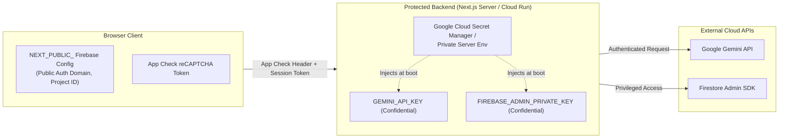
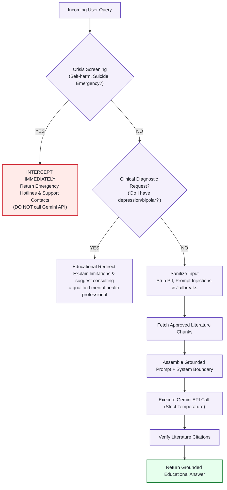

# Security & Privacy Architecture — PsyQuizz

> **Status:** Proposed Security Architecture & Guidelines  
> **Applicable Regulations:** Viet Nam Law on Personal Data Protection (Law No. 91/2025/QH15, effective 1 January 2026), GDPR Principles  
> **Document Version:** 1.0.0  
> **Last Updated:** November 2026

---

## 1. Privacy-by-Design Philosophy

PsyQuizz operates under a strict **Privacy-by-Design** and **Data Minimization** framework. Because psychological self-assessments capture sensitive emotional and behavioral traits, the platform guarantees that users can discover insights about themselves without fear of surveillance, commercial profiling, or unauthorized data retention.

### Core Tenets
1. **Zero Mandatory Account Creation:** Users can complete basic assessments and view comprehensive results anonymously without entering an email address, phone number, or name.
2. **Client-Side Default Execution:** Questionnaire items and raw scoring logic execute strictly within the user's browser runtime. Incomplete or completed survey answers are not streamed to the database.
3. **Transparent Opt-In Persistence:** Cloud storage occurs exclusively when the user deliberately requests to save or bookmark their profile.
4. **Immediate Deletion Right:** Users have immediate, self-service mechanisms to purge any saved session or result.

---

## 2. Anonymous vs. Pseudonymous Identity Model

| Aspect | Guest Mode (Default) | Anonymous Firebase Auth | Registered Account (Optional) |
|---|---|---|---|
| **Identity Type** | Purely Ephemeral (Client In-Memory) | Pseudonymous (App-Specific UID) | Identified (Email / OAuth) |
| **Data Stored on Cloud** | **None** | Optional aggregate scores only | Saved assessment history across devices |
| **Duration** | Browser session only | Retained until cache cleared or user clicks delete | Retained until account deletion |
| **Network Footprint** | Static definition download only | Authenticated API calls | Authenticated API calls |
| **Legal Status** | Non-identifiable data | Pseudonymous data under Law 91/2025/QH15 | Personal data subject to full consent |

> [!IMPORTANT]
> **Technical Accuracy Note:** Firebase Anonymous Authentication generates an app-specific unique identifier (`uid`). This provides **pseudonymity**, not mathematical anonymity. System documentation and user-facing copy must never mislead users into believing Firebase Anonymous Auth makes them untraceable at the network/IP layer.

---

## 3. Database Security & Access Control (Cloud Firestore)

Access to Cloud Firestore is governed by declarative, granular **Firestore Security Rules**. Unauthenticated or cross-tenant client access is blocked by default.

### Blueprint: Firestore Security Rules (`firestore.rules`)

```javascript
rules_version = '2';
service cloud.firestore {
  match /databases/{database}/documents {
    
    // Deny all by default
    match /{document=**} {
      allow read, write: if false;
    }

    // 1. Assessment Definitions (Public read-only, Admin write-only)
    match /assessments/{assessmentId} {
      allow read: if true;
      allow write: if false; // Server Admin SDK only
    }

    // 2. Approved Knowledge Base (Public read-only for educational references)
    match /knowledge_base/{docId} {
      allow read: if true;
      allow write: if false; // Server Admin SDK / Verified Reviewers only
    }

    // 3. User Scoped Data (Strict Owner Isolation)
    match /users/{userId} {
      // User can only read and write their own document
      allow read, write: if request.auth != null && request.auth.uid == userId;

      // User saved assessment results
      match /results/{resultId} {
        allow read, write: if request.auth != null && request.auth.uid == userId;
        // Validate payload structure on write
        allow create, update: if request.resource.data.keys().hasOnly(
          ['assessmentId', 'dimensionScores', 'completedAt', 'instrumentVersion']
        ) && request.resource.data.dimensionScores is map;
      }
    }
  }
}
```

---

## 4. API Credential & Secret Management

Exposing AI or cloud infrastructure keys in client-side code represents a critical security risk.

### Credential Segregation Architecture



### Mandatory Development Rules
1. **Never prefix confidential secrets with `NEXT_PUBLIC_`:** Any variable prefixed with `NEXT_PUBLIC_` is inlined into the client-side JavaScript bundle during the build step and is visible to any visitor.
2. **Never commit `.env` or `.env.local` to Git:** Git repositories must contain only `.env.example` with sanitized placeholders.
3. **Server-Side API Proxying:** The client browser **never** makes direct HTTP requests to `generativelanguage.googleapis.com`. All AI interactions pass through the internal `/api/assistant` route handler, where credentials and rate limits are managed securely.

---

## 5. Firebase App Check & Anti-Abuse Protection

To protect PsyQuizz backend services and the Gemini API quota from automated bot scraping, denial-of-service, or unauthorized usage, **Firebase App Check** must be enforced:
- **Web Platform Provider:** reCAPTCHA v3 or reCAPTCHA Enterprise.
- **Enforcement Points:**
  - Cloud Firestore read/write operations.
  - Server-side Next.js route handlers (`/api/assistant`, `/api/save-results`).
- **Development Workflow:** Developers use registered debug tokens (`NEXT_PUBLIC_APP_CHECK_DEBUG=true`) to enable testing without consuming reCAPTCHA quotas.

---

## 6. AI Safety, Guardrails & Crisis Protocol

PsyQuizz is designed for educational self-discovery. Psychological safety is built directly into the AI interaction pipeline:



### Emergency Support Resources (Viet Nam)
When acute distress or crisis keywords are detected, the system immediately provides validated Vietnamese mental health support resources:
- **Đường dây nóng Ngày Mai (Hỗ trợ người trầm cảm & khủng hoảng tâm lý):** `096 306 1414`
- **Tổng đài Quốc gia Bảo vệ Trẻ em & Thanh thiếu niên:** `111`
- **Cấp cứu Y tế:** `115`

---

## 7. Compliance with Viet Nam Personal Data Protection Law (Law No. 91/2025/QH15)

In compliance with Law No. 91/2025/QH15 (effective 1 January 2026):
1. **Notice & Consent:** Users are explicitly informed of what data is processed and why before starting any assessment.
2. **No Third-Party Ad Profiling:** Assessment answers and scores are strictly prohibited from being sold, leased, or transmitted to third-party ad networks or tracking scripts.
3. **Data Erasure:** A visible "Xóa toàn bộ dữ liệu của tôi" (Delete all my data) control allows users to instantly remove all stored pseudonymous records from Firestore.
4. **Data Minimization:** No demographic or identity attributes are requested unless strictly required for psychometric norming (and even then, only with opt-in anonymized consent).

